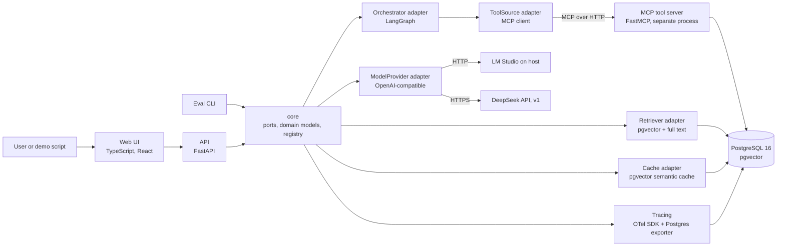
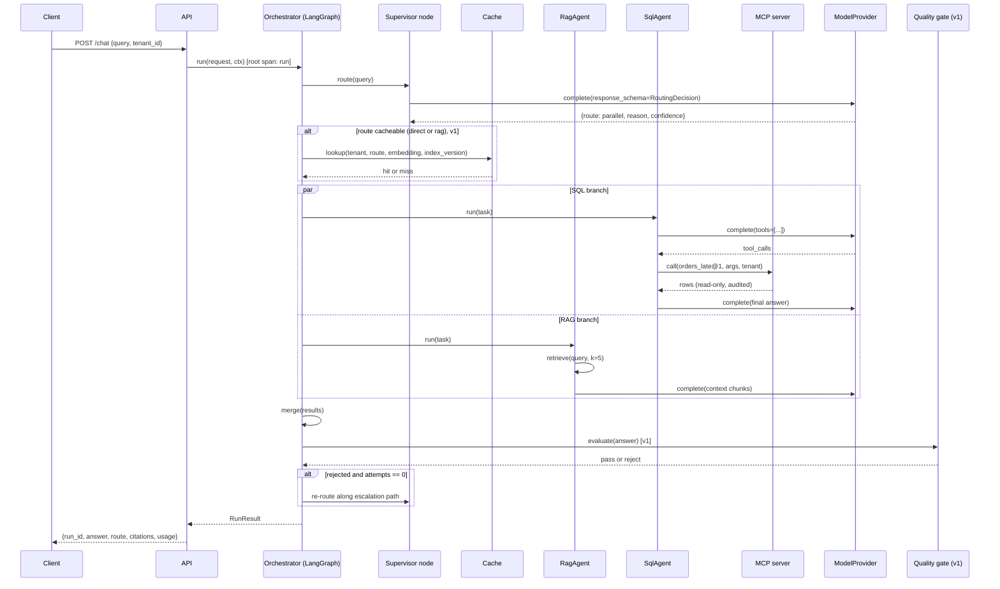
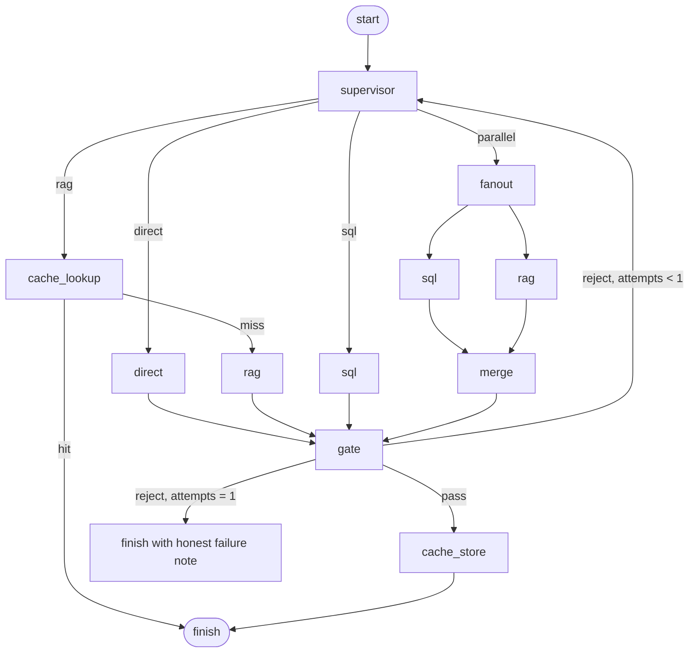
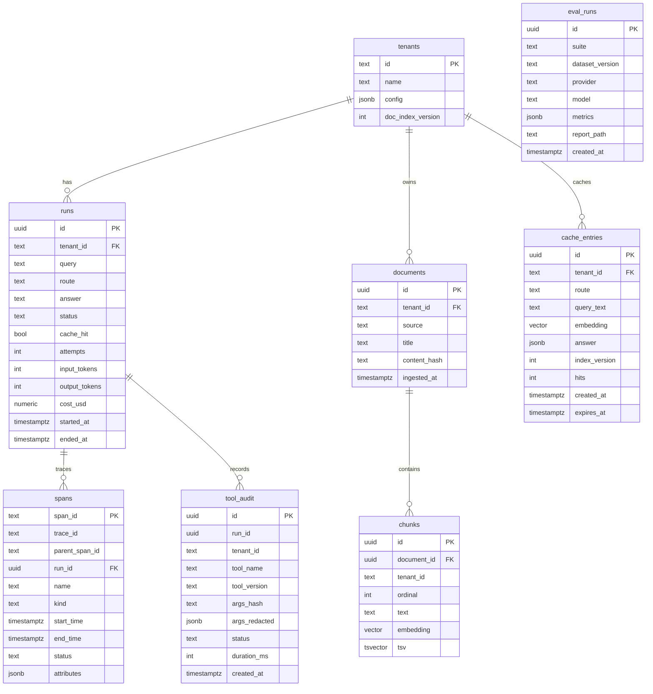

# Switchboard Design

Version 0.1, 2026-11-11. Status: draft for review. Companion to [requirements.md](requirements.md) and the ADRs in [docs/adr](../adr/).

## 1. Overview

Switchboard is a modular monolith built in the ports and adapters style. A small framework-free core defines the interfaces (ports) and domain models. Everything that talks to the outside world (LangGraph, model APIs, MCP, PostgreSQL, OpenTelemetry) is an adapter behind one of those ports and is selected by configuration. Three things run as separate processes because the boundary is real: the MCP tool server (protocol and permission boundary), the web UI (different technology), and PostgreSQL.



## 2. Principles

1. **Core depends on nothing.** `src/switchboard/core` imports only the standard library and pydantic. Enforced by an import-linter contract in CI.
2. **One port, one job.** Each port has a single responsibility and a contract test suite that every adapter must pass.
3. **Configuration selects adapters.** YAML names the adapter; the registry resolves it through Python entry points. New adapters can live in a separate package.
4. **Everything is traced.** Every port call that crosses a process or network boundary creates a span. No span, no feature.
5. **Numbers come from the harness.** No metric is written anywhere without a report file to back it.
6. **Read-only by default.** Tools cannot write. The database role for tools has SELECT only.
7. **Tenant id is not optional.** Every request, record, span and cache entry carries a tenant id even while there is only one tenant.

## 3. Components and responsibilities

| Component | Location | Responsibility | Depends on |
| --- | --- | --- | --- |
| core | `src/switchboard/core` | Ports, domain models, errors, registry, configuration schema | nothing |
| agents | `src/switchboard/agents` | `DirectAgent`, `RagAgent`, `SqlAgent`, `MergeAgent`; each implements `Agent` | core ports |
| orchestrator adapter | `src/switchboard/adapters/orchestrator/langgraph_impl` | Supervisor graph: route, run agents, merge, gate, re-route | core, agents, langgraph |
| provider adapters | `src/switchboard/adapters/providers` | `OpenAICompatibleProvider` (LM Studio, DeepSeek), `MockProvider` (recorded responses) | core, openai SDK |
| embedder adapters | `src/switchboard/adapters/embedders` | `OpenAICompatibleEmbedder`, `MockEmbedder` | core |
| tool source adapters | `src/switchboard/adapters/tools` | `McpToolSource` (client), `InProcessToolSource` (tests) | core, mcp SDK |
| retriever adapters | `src/switchboard/adapters/retrievers` | `PgVectorRetriever` (vector, v1 adds full text and RRF), ingestion pipeline | core, asyncpg |
| cache adapters | `src/switchboard/adapters/cache` | `NoCache`, `PgSemanticCache` (v1) | core, asyncpg |
| tracing | `src/switchboard/tracing` | OTel setup, `PostgresSpanExporter`, span helpers, cost accounting | core, opentelemetry |
| api | `src/switchboard/api` | FastAPI app: chat, runs, trace, audit, health | core, tracing |
| eval | `src/switchboard/eval` | Suites, scorers, runner, report writer, baseline comparison | core |
| mcp server | `mcp_servers/olist` | FastMCP server with read-only tools over the Olist schema, tool manifest, permission check, audit write | mcp SDK, asyncpg; does not import switchboard core |
| web | `web/` | Chat page and trace page | API only |
| data | `data/` | Olist loader, synthetic policy documents, SQL schema | PostgreSQL |

## 4. Ports

All ports are `typing.Protocol` classes with pydantic models for inputs and outputs. Signatures below are the intended shape; details may change during Phase 1 but names are stable.

```python
class ModelProvider(Protocol):
    name: str
    def capabilities(self) -> ProviderCapabilities: ...   # tools, json_schema, streaming, context_window
    async def complete(self, request: CompletionRequest) -> CompletionResponse: ...

class Embedder(Protocol):
    name: str
    dimension: int
    async def embed(self, texts: list[str]) -> list[list[float]]: ...

class ToolSource(Protocol):
    name: str
    async def list_tools(self, ctx: TenantContext) -> list[ToolSpec]: ...
    async def call(self, name: str, args: dict, ctx: TenantContext) -> ToolResult: ...

class Retriever(Protocol):
    name: str
    async def retrieve(self, query: str, ctx: TenantContext, k: int = 5) -> list[RetrievedChunk]: ...

class Cache(Protocol):
    name: str
    async def lookup(self, key: CacheKey) -> CacheHit | None: ...
    async def store(self, key: CacheKey, answer: CachedAnswer) -> None: ...
    async def invalidate(self, tenant_id: str) -> int: ...

class Agent(Protocol):
    name: str
    route: Route
    async def run(self, task: AgentTask, deps: AgentDeps) -> AgentResult: ...

class Orchestrator(Protocol):
    name: str
    async def run(self, request: ChatRequest, ctx: RunContext) -> RunResult: ...

class EvalSuite(Protocol):
    name: str
    def load(self, version: str) -> list[EvalCase]: ...
    async def execute(self, case: EvalCase, deps: EvalDeps) -> EvalOutcome: ...
    def score(self, case: EvalCase, outcome: EvalOutcome) -> Score: ...
```

Key domain models:

```python
class Route(StrEnum): direct, rag, sql, parallel

class RoutingDecision(BaseModel):
    route: Route
    reason: str
    confidence: float          # 0 to 1
    cacheable: bool            # derived: route in {direct, rag}

class CompletionRequest(BaseModel):
    messages: list[Message]
    tools: list[ToolSpec] = []
    response_schema: dict | None = None   # JSON schema for structured output
    temperature: float = 0.0
    max_tokens: int | None = None
    metadata: dict = {}        # run_id, tenant_id, purpose

class CompletionResponse(BaseModel):
    text: str | None
    tool_calls: list[ToolCall]
    parsed: dict | None        # when response_schema was given
    usage: Usage               # input_tokens, output_tokens
    model: str
    provider: str
    latency_ms: int

class ToolSpec(BaseModel):
    name: str
    version: str               # semver, major in the wire name: orders_late@1
    description: str
    input_schema: dict
    risk: Literal["read", "write"] = "read"
    tenant_scoped: bool = False
    sensitive_args: list[str] = []

class AgentResult(BaseModel):
    answer: str
    citations: list[Citation]
    tool_calls: list[ToolCallRecord]
    confidence: float
    usage: Usage
    partial: bool = False      # set when a branch failed inside parallel

class TenantContext(BaseModel):
    tenant_id: str
    allowed_tools: set[str]
    seller_ids: list[str] | None   # None means unrestricted
    provider: str
    retrieval: RetrievalSettings
    cache: CacheSettings
```

Dependencies are injected through `AgentDeps` and `RunContext` (provider, embedder, tool source, retriever, cache, tracer), never imported globally.

## 5. Request flow



## 6. Orchestration

### 6.1 Graph

The LangGraph adapter builds this graph. Nodes are thin: they call agents and ports, they do not contain business logic.



Phase 1 ships supervisor, direct, rag, sql, fanout, merge and finish. `cache_lookup`, `cache_store` and `gate` are pass-through nodes in Phase 1 and get real implementations in v1, so the graph shape does not change between phases.

### 6.2 State

```python
class RunState(TypedDict):
    request: ChatRequest
    tenant: TenantContext
    decision: RoutingDecision | None
    results: dict[str, AgentResult]      # keyed by agent name
    answer: AgentResult | None
    gate: GateVerdict | None
    attempts: int
    cache_hit: bool
    errors: list[ErrorRecord]
```

### 6.3 Supervisor

The supervisor is one structured-output call. The prompt lists the four routes with one-line descriptions, the tool names available to the tenant and the document collections available. The response must validate against `RoutingDecision`. If the provider does not support JSON schema output, the adapter falls back to "JSON in prompt plus parse plus one repair retry" (see 8.2). On the second attempt after a gate rejection the prompt includes the previous route and the gate's reason.

Escalation path on rejection: `direct` to `rag`; `rag` to `parallel`; `sql` to `parallel`; `parallel` to finish with a partial answer.

### 6.4 Agent contract

An agent receives `AgentTask` (query, tenant context, optional prior results for merge, a token budget) and `AgentDeps`. It must:

- return within `task.budget.max_tool_steps` tool iterations (default 4) and `task.budget.max_tokens`;
- never raise for expected failures (empty retrieval, tool permission denied); it sets `partial=True` and explains in `answer`;
- raise only `BudgetExceeded` or provider errors that the orchestrator's retry policy handles.

### 6.5 Parallel execution

`fanout` schedules the `sql` and `rag` nodes with LangGraph's parallel branches. `merge` waits for both. If one branch raises, its `AgentResult` is replaced by a partial result with the error and the merge agent is told which source is missing (AC-04c).

### 6.6 Retries and timeouts

| Failure | Policy |
| --- | --- |
| Provider timeout or 429 or 5xx | Retry twice with exponential backoff (1 s, 3 s); then fallback provider if the tenant config names one (v1); then `ProviderUnavailable` |
| Provider 4xx (auth, invalid request) | No retry, fail fast |
| Structured output does not validate | One repair call with the validation error appended |
| Tool validation error | Returned to the model once as a tool error message so it can fix the arguments |
| Tool execution error | One retry; then the agent continues without that tool result |
| Tool permission denied | No retry; recorded; agent continues |
| Whole run | Hard timeout from config (default 60 s); the run ends with status `timeout` and whatever partial answer exists |

### 6.7 Human-in-the-loop (v2)

LangGraph interrupts are placed before any tool call whose `ToolSpec.risk == "write"` or whose name is in the tenant's `require_approval` list. The run is persisted with status `waiting_approval` and resumed through `POST /runs/{id}/approve` or `/reject`. In Phase 1 and v1 no tool has risk `write`, so the hook exists but never fires.

## 7. Tool layer

### 7.1 MCP server

`mcp_servers/olist` is a FastMCP server exposed over streamable HTTP. It owns a connection pool to PostgreSQL using the `switchboard_tools` role, which has `SELECT` on the `olist` schema and nothing else. Every tool runs inside `SET TRANSACTION READ ONLY` with `statement_timeout = 5s` and a row cap of 200.

Phase 1 tools (all `risk: read`, all parameterized, no free-form SQL):

| Tool | Arguments | Tenant scoped |
| --- | --- | --- |
| `orders_summary@1` | `date_from`, `date_to`, `status?` | yes (seller filter) |
| `orders_late@1` | `date_from`, `date_to`, `min_days_late?` | yes |
| `order_lookup@1` | `order_id` | yes |
| `top_products@1` | `date_from`, `date_to`, `metric: revenue or count`, `limit` | yes |
| `describe_schema@1` | none | no |

v2 adds `query_readonly_sql@1`: free-form SELECT validated with sqlglot (single statement, no CTE writes, allowed tables only), still inside a read-only transaction, disabled by default in the tenant config.

### 7.2 Tool manifest and versioning

The manifest (`mcp_servers/olist/manifest.yaml`) is the source of truth for `ToolSpec`. The wire name is `name@major`. Rules:

- Adding an optional argument or a result field is a minor change; the wire name stays.
- Removing or renaming an argument, changing a type or changing semantics is a major change; the server serves both majors for one phase and the old one logs a deprecation warning.
- The eval `toolcall` dataset pins tool versions so a major bump cannot silently change scores.

### 7.3 Permission model

```yaml
# config/tenants.yaml
tenants:
  default:
    provider: lmstudio
    tools:
      allow: ["orders_summary@1", "orders_late@1", "order_lookup@1", "top_products@1", "describe_schema@1"]
      require_approval: []
    seller_ids: null          # unrestricted
  seller_a:
    provider: lmstudio
    tools:
      allow: ["orders_summary@1", "order_lookup@1"]
    seller_ids: ["3442f8959a84dea7ee197c632cb2df15"]
```

Enforcement happens twice: the `McpToolSource` filters `list_tools` by the allowlist so the model never sees a denied tool, and the MCP server checks the allowlist again on every call using the tenant id passed in request metadata, because the client side is not a trust boundary. Tenant-scoped tools receive the tenant's `seller_ids` from the server-side tenant config, never from model-generated arguments.

### 7.4 Audit

The MCP server writes one row to `tool_audit` per call before returning (tenant id, tool, version, SHA-256 of canonical JSON args, redacted args, status, duration, run id from metadata). The audit write is inside the tool span so a failed audit write fails the call.

## 8. Model layer

### 8.1 Provider adapter

`OpenAICompatibleProvider` wraps the official `openai` Python client with a configurable `base_url`, API key and model name. It covers LM Studio (`http://host.docker.internal:1234/v1`), DeepSeek and later any compatible gateway. `capabilities()` is declared in config per model, not probed, because small local models often accept a `tools` parameter and then ignore it.

```yaml
# config/providers.yaml
providers:
  lmstudio:
    adapter: openai_compatible
    base_url: ${LMSTUDIO_BASE_URL}
    api_key: lm-studio
    model: ${LMSTUDIO_MODEL}
    capabilities: {tools: true, json_schema: false, streaming: true, context_window: 8192}
    price: {input_per_1m: 0, output_per_1m: 0, note: "local, no API cost"}
  deepseek:
    adapter: openai_compatible
    base_url: https://api.deepseek.com/v1
    api_key: ${DEEPSEEK_API_KEY}
    model: deepseek-chat
    capabilities: {tools: true, json_schema: true, streaming: true, context_window: 65536}
    price: {input_per_1m: 0.27, output_per_1m: 1.10, note: "verify against the provider price page before each comparison run"}
  mock:
    adapter: mock
    fixtures: evals/fixtures/mock_provider
```

### 8.2 Structured output strategy

In order of preference, chosen by `capabilities.json_schema`:

1. Native JSON schema response format.
2. Tool-call trick: declare one tool whose input schema is the target schema and force its use.
3. Prompted JSON: schema in the system prompt, parse the first JSON object in the reply, one repair round on validation failure.

The chosen strategy is recorded as a span attribute so eval reports can break down accuracy by strategy.

### 8.3 Tool call normalization

Tool calls from any provider are normalized to `ToolCall(name, arguments: dict, call_id)`. Arguments that arrive as a JSON string are parsed; failures become a tool validation error returned to the model (6.6).

### 8.4 Fallback and routing by policy (v1, v2)

v1: a tenant may name a `fallback_provider`; it is used after the retry budget of the primary is exhausted. v2: a `ModelRouter` policy chooses a provider per call based on purpose (routing decisions on a cheap fast model, final answers on a stronger one), with cost and latency ceilings from the tenant config. Both are implemented as a `ModelProvider` decorator so agents do not know about them.

## 9. Knowledge layer

### 9.1 Ingestion

`switchboard ingest <path> --tenant default` reads markdown and text files, splits on headings then on a token window (512 tokens, 64 overlap), embeds with the configured `Embedder`, and writes `documents` and `chunks`. Content hash per document prevents duplicate work. After a successful ingest the tenant's `doc_index_version` is incremented, which invalidates the semantic cache for that tenant (10.3).

Demo corpus: synthetic policy documents written for this project (returns, shipping, seller onboarding, payment methods, late delivery compensation), clearly marked as synthetic. See ADR 0010.

### 9.2 Retrieval

Phase 1: cosine similarity on pgvector (HNSW index), top k.

v1: hybrid search. Full-text search through a `tsvector` column with `ts_rank`, vector search as before, combined with reciprocal rank fusion (k = 60). Optional re-ranking of the top 20 by a local cross-encoder; the `rag` eval suite reports recall@5 for vector only, hybrid, and hybrid plus re-rank so the README can show the actual gain.

### 9.3 Chunk format to the model

Retrieved chunks are passed as data blocks:

```
<document id="doc_12" chunk="3" source="returns-policy.md">
...text...
</document>
```

with a system instruction that content inside `document` and `tool_result` blocks is untrusted data and never an instruction (see 13.1).

## 10. Semantic cache (v1)

### 10.1 Scope

Lookup happens only when `RoutingDecision.cacheable` is true, which is the case for `direct` and `rag`. `sql` answers depend on parameters such as dates where two near-identical questions have different answers, and `parallel` contains an `sql` part, so neither is cached.

### 10.2 Key and match

`CacheKey = (tenant_id, route, normalized_query, embedding, index_version)`. A hit requires same tenant, same route, same index version and cosine similarity above the threshold. The threshold default is 0.92 and is tuned on the `cache` suite: the suite contains paraphrase pairs (should hit) and near-miss pairs (must not hit, for example "return window for electronics" versus "return window for furniture"). The report shows hit rate and false-hit rate for several thresholds; the chosen value and the report path go into the config comment.

### 10.3 Invalidation

Entries carry the `index_version` at store time. Ingestion bumps the tenant's version; old entries stop matching and are deleted by a nightly job or on the next store. A TTL (default 7 days) covers `direct` answers that do not depend on documents.

### 10.4 Measurement

Each lookup creates a span with `switchboard.cache.hit`, `switchboard.cache.similarity` and `switchboard.cache.threshold`. Runs record `cache_hit`. The run cost for a hit is the embedding cost only.

## 11. Multi-tenancy

Logical isolation, enforced at every layer:

| Layer | Isolation mechanism |
| --- | --- |
| API | `tenant_id` required on every request; unknown tenant is a 404 |
| Config | `TenantContext` resolved once per run from `config/tenants.yaml` |
| Tools | Allowlist on client and server; seller filter injected server-side |
| Retrieval | `WHERE tenant_id = $1` on every chunk query; tests assert no cross-tenant chunk ever appears |
| Cache | tenant id in the key |
| Traces and runs | tenant id attribute on every span; run queries filter by tenant |
| Audit | tenant id column |

Physical isolation (schema per tenant, separate databases) is explicitly out of scope and noted as a v2+ option in the review.

## 12. Observability

### 12.1 Instrumentation

The code uses the OpenTelemetry API directly. Span names and attributes follow the GenAI semantic conventions where they exist and a `switchboard.*` namespace otherwise.

| Span | Kind | Key attributes |
| --- | --- | --- |
| `run` | server | `switchboard.tenant_id`, `switchboard.route`, `switchboard.cache.hit`, `switchboard.attempts` |
| `supervisor.route` | internal | `switchboard.route`, `switchboard.route.confidence`, `switchboard.route.reason` |
| `agent.<name>` | internal | `switchboard.agent`, `switchboard.partial` |
| `chat <model>` | client | `gen_ai.operation.name=chat`, `gen_ai.system`, `gen_ai.request.model`, `gen_ai.usage.input_tokens`, `gen_ai.usage.output_tokens`, `switchboard.structured_output.strategy`, `switchboard.cost_usd` |
| `embeddings <model>` | client | `gen_ai.operation.name=embeddings`, token usage |
| `execute_tool <name>` | client | `gen_ai.tool.name`, `switchboard.tool.version`, `switchboard.tool.args_hash`, `switchboard.tool.status` |
| `retrieve` | internal | `switchboard.retrieval.k`, `switchboard.retrieval.strategy`, `switchboard.retrieval.hits` |
| `cache.lookup` | internal | see 10.4 |
| `gate` | internal | `switchboard.gate.verdict`, `switchboard.gate.score` |

### 12.2 Export and storage

A custom `PostgresSpanExporter` (batched through the SDK's `BatchSpanProcessor`) writes spans to the `spans` table. Because the API, the orchestrator and the eval CLI are one process, there is no collector in Phase 1. The MCP server runs its own exporter with the same table and propagates trace context from the request metadata, so tool spans attach to the run's trace. v1 adds an OTLP exporter and a Jaeger container to show that the same spans render in a standard tool (one config switch).

### 12.3 Trace API and UI

`GET /runs/{id}/trace` assembles the span tree for the run. The web UI's trace page has three panes: run list (left), the run's span tree with duration bars (center), and the selected span's attributes, prompt excerpt and tool arguments (right). v1 replaces the tree with a timeline and adds a graph view of the routing path. Visual style is decided in a separate design pass.

The author's `langgraph-visualizer` project can be attached as an optional development tool: the LangGraph adapter exposes its compiled graph so `watch(graph)` can wrap it. It is not part of the platform's trace path because it is specific to LangGraph and the platform's trace must survive an orchestrator swap.

### 12.4 Cost accounting (v1)

`config/prices.yaml` holds input and output prices per million tokens per provider and model, with a `verified_on` date. The provider adapter computes cost per call from usage and writes it on the span; the run aggregates it. Local models cost zero and the report labels them "no API cost" rather than "free".

## 13. Security

### 13.1 Prompt injection in tool results and documents

- All external content reaches the model inside `tool_result` or `document` blocks with an id and a system instruction that such content is data.
- v1 adds a detector in `core/guardrails.py` with a versioned pattern set (instruction-like phrases, role impersonation, requests to call tools or reveal prompts, encoded payloads). Flagged content is wrapped with `flagged="true"` and a note; the span records the pattern id. Detection quality is measured by the `injection` suite; patterns are extended from failures, not from guesses.
- Tool arguments produced by the model never include tenant identity or seller ids; those come from server-side config.

### 13.2 Secrets

API keys come from environment variables through `.env` (git-ignored) with an `.env.example`. No secret is logged; the provider adapter redacts `Authorization` headers in debug logs. v2 moves cloud secrets to Azure Key Vault.

### 13.3 Audit

See 7.4. The audit table is append-only (no UPDATE or DELETE grant for the application role).

## 14. Data model



The Olist tables live in a separate schema `olist` loaded from the public CSV files. Two database roles: `switchboard_app` (read and write on the platform tables, no access to `olist` except through views if needed) and `switchboard_tools` (SELECT on `olist`, INSERT on `tool_audit`, nothing else).

## 15. Error handling

Error taxonomy in `core/errors.py`:

| Error | Retryable | Raised by | Handled by |
| --- | --- | --- | --- |
| `ProviderTransientError` | yes | provider adapter | retry policy, then fallback |
| `ProviderRequestError` | no | provider adapter | run fails with status `provider_error` |
| `StructuredOutputError` | once (repair) | provider adapter | repair call, then route defaults to `parallel` for the supervisor, or agent returns partial |
| `ToolValidationError` | once (model fixes args) | tool source | agent loop |
| `ToolExecutionError` | once | tool source | agent loop, then partial |
| `ToolPermissionError` | no | tool source | agent continues, audit records denial |
| `RetrievalError` | once | retriever | agent returns partial |
| `BudgetExceeded` | no | agent | orchestrator finishes with partial answer |
| `GateRejected` | once (re-route) | gate | supervisor |
| `RunTimeout` | no | orchestrator | run status `timeout` |

Every error becomes an `ErrorRecord` in the run state and a span event, so the trace shows what went wrong even when the run ends with an answer.

## 16. Configuration and registry

Three YAML files (`config/providers.yaml`, `config/tenants.yaml`, `config/platform.yaml`) plus `.env` for secrets. `platform.yaml` selects adapters:

```yaml
orchestrator: langgraph
tool_sources:
  - name: olist
    adapter: mcp
    url: ${MCP_OLIST_URL}
retriever: pgvector
cache: none              # v1: pg_semantic
embedder: lmstudio
tracing:
  exporter: postgres     # v1: postgres, otlp
limits:
  run_timeout_s: 60
  max_tool_steps: 4
```

The registry resolves adapter names through entry points declared in `pyproject.toml`:

```toml
[project.entry-points."switchboard.orchestrators"]
langgraph = "switchboard.adapters.orchestrator.langgraph_impl:LangGraphOrchestrator"

[project.entry-points."switchboard.providers"]
openai_compatible = "switchboard.adapters.providers.openai_compat:OpenAICompatibleProvider"
mock = "switchboard.adapters.providers.mock:MockProvider"
```

A third-party package can add an adapter by declaring the same entry point group; no change in this repository is needed. Agents and eval suites use the same mechanism.

## 17. Repository layout

```
switchboard/
  README.md  LICENSE  CLAUDE.md  pyproject.toml  uv.lock  docker-compose.yml  .env.example
  config/            providers.yaml  tenants.yaml  platform.yaml  prices.yaml
  docs/
    spec/            requirements.md  design.md  tasks.md  review.md
    adr/             0001-...md
    demo.md          five minute demo script
  src/switchboard/
    core/            ports.py  models.py  errors.py  registry.py  config.py  guardrails.py
    agents/          direct.py  rag.py  sql.py  merge.py  prompts/
    adapters/
      orchestrator/  langgraph_impl/   sequential/ (v2)
      providers/     openai_compat.py  mock.py  fallback.py (v1)
      embedders/     openai_compat.py  mock.py
      tools/         mcp_client.py  in_process.py
      retrievers/    pgvector.py  ingest.py
      cache/         none.py  pg_semantic.py (v1)
    tracing/         setup.py  pg_exporter.py  spans.py  cost.py
    api/             app.py  routes/  schemas.py
    eval/            runner.py  suites/  scorers/  report.py  baseline.py
    cli.py
  mcp_servers/olist/ server.py  tools/  manifest.yaml  db.py
  web/               package.json  src/  (Vite, React, TypeScript)
  data/
    olist/           README.md (download steps)  schema.sql  load.py
    documents/       synthetic policy markdown files
  evals/
    datasets/v1/     routing.jsonl  toolcall.jsonl  rag.jsonl (v1)  cache.jsonl (v1)  gate.jsonl (v1)  injection.jsonl (v1)
    baselines/       routing.json  toolcall.json
    fixtures/        mock_provider/
    reports/         generated, committed selectively
  tests/
    unit/  contracts/  integration/
  .github/workflows/ci.yml
```

## 18. Testing strategy

| Level | What | Tooling | Runs in CI |
| --- | --- | --- | --- |
| Unit | core models, registry, routing prompt builders, scorers, guardrails | pytest, no I/O | yes |
| Contract | every adapter of a port passes the same test module, parameterized by adapter; providers use recorded fixtures | pytest | yes |
| Integration | API plus orchestrator plus MCP server against PostgreSQL, with `MockProvider` | pytest, PostgreSQL service container | yes |
| Eval smoke | `routing` and `toolcall` suites on `mock`, compared to baselines | `switchboard eval run` | yes, gate |
| Eval full | all suites on `lmstudio` and, with explicit flag and cost cap, `deepseek` | manual, reports committed | no |
| Live smoke | one real request against LM Studio | manual script | no |

Fixtures for the mock provider are recorded from real runs with a `--record` flag and reviewed before commit so the CI numbers are not fiction; the README labels them as "mock provider, measures the pipeline, not the model".

## 19. Deployment

Phase 1 and v1: `docker-compose.yml` with services `postgres` (pgvector image, volume, init SQL for roles and schema), `api` (uvicorn), `mcp-olist`, `web` (static build served by nginx or Vite preview). LM Studio runs on the host and is reached through `host.docker.internal`. Health checks on every service; `api` waits for `postgres` and `mcp-olist`.

v2 (optional): Azure Container Apps for `api`, `mcp-olist` and `web`, Azure Database for PostgreSQL flexible server with pgvector, Key Vault for secrets, Terraform in `infra/`, GitHub Actions workflow that builds images on tag and applies Terraform with a manual approval environment.

## 20. Evaluation design

### 20.1 Datasets

JSONL, versioned by directory (`evals/datasets/v1`). A dataset version never changes after a report references it; fixes go into v2.

| Suite | Case fields | Size (Phase 1 or v1) | Scorer |
| --- | --- | --- | --- |
| routing | `query`, `expected_route`, `tags` | 60, balanced across routes, 15 ambiguous | exact match; confusion matrix in report |
| toolcall | `query`, `expected_tool`, `expected_args`, `tool_version` | 40 | tool name match and argument AST match (required args exact, optional args if present) |
| rag (v1) | `query`, `relevant_chunk_ids`, `answer_rubric` | 40 | recall@5, MRR; rubric scoring by judge in v2 |
| cache (v1) | `query_a`, `query_b`, `should_hit` | 50 pairs | hit rate, false-hit rate per threshold |
| gate (v1) | `query`, `answer`, `is_weak` | 30 | precision, recall |
| injection (v1) | `content`, `is_malicious` | 40 | detection rate, false positive rate |

### 20.2 Runner

`switchboard eval run --suite <name> --provider <name> [--limit n] [--record]` executes cases concurrently (bounded), times each, collects usage, scores, and writes a markdown and a JSON report. `--provider deepseek` prints the estimated cost from the price table and the case count and refuses to proceed without `--confirm-cost` or above the cap in `platform.yaml`.

### 20.3 Comparison and regression

`switchboard eval compare` merges JSON reports into one table. `switchboard eval gate --suite routing --baseline evals/baselines/routing.json --max-drop 0.05` exits non-zero when accuracy drops more than the delta; CI runs this on the mock provider. Baselines are updated deliberately by committing a new file, never automatically.
