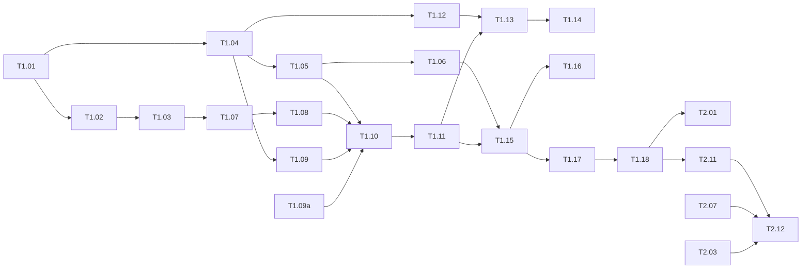

# Switchboard Roadmap and Tasks

Version 0.2, 2026-11-12. Status: draft for review.

Phases: **Phase 1** is the smallest impressive demo, **v1** completes the platform story, **v2** is the stretch roadmap. Every task is small enough for one or two evenings, independently verifiable, and linked to acceptance criteria in [requirements.md](requirements.md). Estimates are hours of focused work and include tests.

Conventions for every task: tests pass locally, `ruff` and `mypy` clean, a span exists for any new boundary call (OTel API from T1.05 on; it is a no-op until T1.12), and anything that changes an interface gets a line in the relevant ADR or a new ADR.

Tags in the task column:

- **[host]**: needs the author's machine (LM Studio, Docker Desktop, the downloaded Olist data). A coding agent without access prepares everything it can, then stops and lists the exact commands for the author to run.
- **[human]**: content the author writes or reviews line by line, because an agent that also writes the prompts would be grading its own work (review R7).

Progress lives in [progress.md](progress.md): one line per task with status and the commit that finished it. A session updates it in the same commit as the work.

## Phase 1: smallest impressive demo

Target: about 45 hours, roughly three weeks of evenings. Definition of done: the five minute demo in section "Phase 1 demo script" runs from a fresh clone with LM Studio on the host, and the README shows one measured routing and tool-call report.

| ID | Task | Est. h | Verification | AC |
| --- | --- | --- | --- | --- |
| T1.01 | Repo scaffold: `pyproject.toml` with uv, ruff, mypy strict, pytest, pre-commit, import-linter contract "core imports nothing", CI job for lint and unit tests | 1.5 | `uv run pytest` green with one placeholder test; CI green on push | G1 |
| T1.02 | **[host]** Docker Compose: `postgres` (pgvector image, init SQL creating schemas, roles `switchboard_app` and `switchboard_tools`), `api`, `mcp-olist`, `web` placeholders, health checks, `.env.example` including the run token secret, startup refusal when the secret is missing | 1.5 | `docker compose up` shows all services healthy; `GET /health` lists dependencies; LM Studio reachable from the `api` container; chat and embedding models (design 8.1) loaded together, measured VRAM recorded in `docs/progress.md` | AC-17a |
| T1.03 | **[host]** Olist loader: `data/olist/README.md` with download steps, `schema.sql`, `switchboard data load-olist <dir>` loading the CSV files into schema `olist`, row count check; a reproducible script that extracts the 1000-row test sample with its CC BY-NC-SA attribution | 2 | First load: the loader prints row counts and they are recorded in `data/olist/README.md` (actual numbers from the load, never typed from memory); later loads compare against them. `switchboard_tools` can SELECT and cannot INSERT (test) | AC-02b |
| T1.04 | Core: ports, domain models (`AgentSpec`, `RoutingDecision` as a plan, `Usage` with cached tokens, `ToolResultView`, `Citation`), plan validation, `ClearOldestToolResults` context policy, errors, config loader (YAML plus env substitution), registry over entry points including agents | 3 | Unit tests for config parsing, registry resolution, plan validation and context policy; mypy strict passes | AC-01b, AC-01d, AC-21c |
| T1.05 | **[host]** for the live smoke only. `OpenAICompatibleProvider`: completion, tool call normalization, reasoning output separation, usage normalization including cached input tokens, structured output strategies 1 to 3 with repair, error mapping, latency | 3 | Contract tests on recorded fixtures; live smoke script against LM Studio prints a plan | AC-08b |
| T1.06 | **[host]** for recording only. `MockProvider` with fixture recording, keyed replay and loud misses, `MockEmbedder`, `OpenAICompatibleEmbedder` | 1 | Contract tests pass for mock; a changed prompt produces a clear "re-record" failure | AC-06c, AC-14c |
| T1.07 | MCP server `olist`: FastMCP over streamable HTTP, manifest, five read-only tools returning aggregates first, read-only transaction, statement timeout, row cap, run token verification, tenant allowlist check, audit insert with `audit_id` in the result | 3.5 | MCP inspector lists five tools; integration test calls each tool; write attempt fails; missing, forged and expired tokens rejected; tenant in args ignored; audit row appears | AC-02a to AC-02c, AC-07b, AC-11d |
| T1.08 | `McpToolSource` adapter: list and call with bearer run token and `traceparent`, error mapping including `RunTokenError` | 1.5 | Contract tests against the server in a test container; denied tool is filtered from `list_tools` | AC-07b |
| T1.09 | Ingestion and `PgVectorRetriever`: chunking, embedding, upsert with content hash, HNSW index, vector search; write five synthetic policy documents | 2.5 | `switchboard ingest data/documents` twice: second run reports zero changes; retrieval test returns the expected chunk for three queries | AC-03b, AC-03c |
| T1.09a | **[human]** Eval datasets v1, finished before any agent prompt exists (method in `evals/datasets/v1/README.md`). Routing: a separate session that has read only `evals/briefs/routing-v1.md` writes 60 questions and its own labels; the author labels blind with `label_routing.py`; `merge_routing.py` tags disagreements `ambiguous` and assigns dev and test splits. Toolcall: `gen_toolcall.py` generates 40 cases from templates (order ids sampled from the Olist data), the author reviews the wording | 1.5 | `validate.py routing` and `validate.py toolcall` pass; agreement rate recorded and the author signs off in `docs/spec/progress.md`; datasets committed before T1.10 starts | AC-06a |
| T1.10 | Agents: `DirectAgent`, `DocsAgent` and `DataAgent` with specs, prompt builders in the stable prefix layout, citation markers and parsing, `ToolResultView` and run-scoped result store, platform tool `result_page@1`, context policy on every call; `MergeAgent` with missing-source handling | 4.5 | Unit tests with mock provider and in-process tool source; prefix stability test; a 500-row result shows at most 20 rows to the model; partial result when a branch fails | AC-02d, AC-03a, AC-04b, AC-04c, AC-19c, AC-21a, AC-21b |
| T1.11 | LangGraph orchestrator: generic plan graph (pass-through cache lookup, supervisor with generated prompt and schema, `Send` fan-out, `run_agent`, merge, pass-through gate and cache store), reducers on parallel state, attempts counter, run timeout | 3.5 | Integration test with mock provider covers plans `direct`, `docs`, `data`, `data+docs` and an invalid plan; parallel spans overlap in time; a fake fourth agent registered in a test appears in the supervisor prompt without code changes | AC-01b, AC-01c, AC-01d, AC-04a |
| T1.12 | Tracing: OTel setup, `PostgresSpanExporter`, span helpers with GenAI and context attributes, run row inserted at start, `force_flush` before response, MCP server flush per call, full tool result as span event | 2.5 | After one request, the trace read immediately contains run, supervisor, agent, chat and tool spans from both processes | AC-05a, AC-05b, AC-05d, AC-21d |
| T1.13 | API: `POST /chat`, `POST /chat/stream` (SSE from `StepEventProcessor`), `GET /runs`, `GET /runs/{id}`, `GET /runs/{id}/trace`, `GET /health`; run token minting; request validation; unknown tenant 404 | 3 | HTTP tests; SSE test receives the expected event sequence; OpenAPI docs render | AC-01a, AC-05a, AC-22a |
| T1.14 | Web UI (functional, unstyled): chat page with live steps and citation chips, run list, trace tree with expand and collapse, attribute pane with full tool result | 3.5 | Manual check against the API; a citation chip opens the cited span; builds in CI | AC-05c, AC-22b |
| T1.15 | Eval harness: runner, report writer, `routing` and `toolcall` suites over the T1.09a datasets, scorers (set match, Jaccard, AST match, tool calls per case), `--provider mock` path | 2.5 | `switchboard eval run --suite routing --provider mock` finishes under 30 s and writes both report files | AC-06a to AC-06c |
| T1.16 | CI: integration tests with a PostgreSQL service, eval smoke on mock, regression gate against baselines | 1.5 | A deliberate scorer change makes CI fail; revert makes it pass | AC-14a, AC-14b |
| T1.17 | **[host]** First measured report on LM Studio: run both suites, commit reports, update the metrics table status from target to measured | 1.5 | Report files exist; README numbers link to them | G3 |
| T1.18 | **[host]** README quick start (including what the CI gate measures), `docs/demo.md` five minute script, walkthrough "add a tool in three steps" | 1.5 | Fresh clone test following the README; timing recorded | AC-07a, AC-14c, AC-17b |

Total: 45 hours as estimated, of which 1.5 hours (T1.09a) are the author's own labeling and review. The growth from 0.1 (39 hours) comes from plan validation and context policy in core, run tokens, bounded tool views, data citations, step streaming, the prefix layout, and splitting dataset authoring out of the harness task. See [review.md](review.md) for the cut order.

### Phase 1 demo script (five minutes)

1. `docker compose up` already running; show `GET /health` (30 s).
2. Ask "What is the return window for electronics?" in the UI; watch the steps arrive; show plan `docs` and the document citation (45 s).
3. Ask "How many orders were delivered late in March 2018?"; show plan `data`; click the citation chip on the number, which opens the tool span with arguments, the full result and the audit row (75 s).
4. Ask "Were late deliveries in March eligible for compensation?"; show plan `data+docs`, overlapping spans, merged answer with both kinds of citations (60 s).
5. Open `evals/reports/`, show the plan confusion matrix and the tool-call accuracy for the local model; say which numbers are measured and which are targets (45 s).
6. Show `mcp_servers/olist/tools/orders_late.py` and the manifest entry; explain that adding a tool is this file plus one manifest entry, and adding an agent is one class plus one entry point (45 s).

## v1: the platform story

Target: about 48 hours without the semantic cache, 53 with it. Definition of done: comparison report across two providers and two orchestrators, gate measured, tenant permissions demonstrated, follow-up questions work. Tasks are ordered by priority; the semantic cache is last and is the first to cut.

| ID | Task | Est. h | Verification | AC |
| --- | --- | --- | --- | --- |
| T2.01 | Quality gate: deterministic checks (numbers grounded, citations valid, evidence present, merge complete), Reflexion-style retry with feedback, re-plan with a different plan, attempts limit, `gate` dataset with 30 cases, per-check precision and recall | 4 | Integration test: an ungrounded number triggers one retry, empty evidence triggers one re-plan; report file | AC-09a to AC-09c |
| T2.02 | Tenant configuration: `tenants.yaml` schema with agent and tool allowlists, second demo tenant with seller filter, cross-tenant tests | 3 | Tenant B cannot see tenant A's orders or chunks; denied tool shows in trace and audit | AC-11a to AC-11c |
| T2.03 | Retrieval: hybrid search (`tsvector`, RRF), optional cross-encoder re-rank, conditional query rewriting with at most two rounds, `rag` dataset with 40 cases, recall@5 report for four strategies | 6 | Report shows all four strategies on the same dataset | AC-25a, AC-25b |
| T2.04 | Injection guardrail: pattern set, flagging in blocks, span attributes, `injection` dataset with 40 samples, report | 3 | Report with detection and false positive rate | AC-12a to AC-12c |
| T2.05 | Audit API: `GET /audit`, redaction by `sensitive_args`, append-only grants test | 1.5 | HTTP test; grant test | AC-18a, AC-18b |
| T2.06 | Cost accounting: `prices.yaml` with cached input price, verified dates and source URLs, per-call cost on spans, per-run aggregation, `GET /runs` aggregation by day and provider | 2.5 | Unit test for price math including cached tokens; API test | AC-19a, AC-19b |
| T2.07 | DeepSeek provider config, cost cap and confirmation in the runner, fallback provider decorator | 2 | Dry run prints estimate and refuses without confirm; fallback test with a failing primary | AC-13b |
| T2.08 | Answer token streaming: provider streaming, `answer.delta` events, UI rendering | 2 | SSE test receives deltas that concatenate to the final answer | AC-22c |
| T2.09 | Sessions and clarification: `session_id`, last N turns to supervisor and rewriting, `ClarifyAgent` added through one entry point, `needs_clarification` status | 3 | "And in April?" test; a diff shows no change under `core` or the orchestrator for the clarify agent | AC-23a to AC-23c |
| T2.10 | Feedback: `POST /runs/{id}/feedback`, `switchboard eval harvest`, UI thumbs | 1.5 | Harvest writes candidate cases for negative ratings only | AC-24a, AC-24b |
| T2.11 | `AgentLoopOrchestrator`: single model, all tenant tools plus `search_docs@1` and `result_page@1`, bounded loop, derived plan; orchestrator contract tests shared with LangGraph | 5 | Contract tests pass for both; routing suite runs with `--orchestrator agent_loop` | AC-16a, AC-16b |
| T2.12 | Comparison: run routing, toolcall and rag on LM Studio and DeepSeek for both orchestrators; `eval compare` table; README section on what the comparison showed | 4 | Comparison report committed; README table links to it | AC-13a |
| T2.13 | OTLP exporter option and Jaeger container in a compose profile | 1.5 | Same run visible in Jaeger | design 12.2 |
| T2.14 | Trace UI v2: timeline view, plan graph, cache and gate markers (functional, not styled) | 4 | Manual check; screenshots in docs | AC-05c |
| T2.15 | Contract test suite completed for all ports with two implementations each where available | 2 | `pytest tests/contracts` parameterized over registered adapters | AC-08b |
| T2.16 | Optional (skipped by the author on 2026-11-12): `langgraph-visualizer` dev integration flag | 0 | Cancelled; recorded as skipped in progress.md | design 12.3 |
| T2.17 | Docs: update ADRs, write interview notes (`docs/interview-notes.md`) with one paragraph per decision | 2 | Review by reading aloud in five minutes | G5 |
| T2.18 | Semantic cache (cut first if v1 runs long): `PgSemanticCache` before the supervisor, key scoping, TTL, invalidation on ingest, cache spans, `cache` dataset with 50 pairs including cross-type near misses, threshold sweep report | 5 | Test: paraphrase hits, near miss does not, re-ingest invalidates, hit makes no model call; report with threshold table | AC-10a to AC-10d |

## v2: stretch roadmap

Not estimated in detail. Order reflects interview value per hour.

| ID | Task | Why | AC |
| --- | --- | --- | --- |
| T3.01 | Human-in-the-loop: interrupt before `write` or `ask` tools, `waiting_approval` status, approve and reject endpoints, one demo write tool behind approval | Shows the safety story end to end | AC-15a, AC-15b |
| T3.02 | `ModelRouter` policy: cheap model for plans, strong model for answers, optional reasoning mode, cost and latency ceilings, measured savings | Routing by cost, latency and capability | design 8.4 |
| T3.03 | Visual design pass (Apple-like style decided in a separate design session), responsive layout, design checklist in `docs/ui.md` | Demo polish, moved from v1 | G4 |
| T3.04 | LLM judge as gate layer 2 and as answer quality scorer for the rag suite, with agreement check against a small human-labeled sample | Honest quality metric | AC-09, metric table |
| T3.05 | `query_readonly_sql@1` with sqlglot validation, disabled by default | Shows how a riskier tool is contained | design 7.1 |
| T3.06 | Anthropic provider adapter (native tool use, structured output, prompt caching) | Third provider, native tools comparison | AC-08a |
| T3.07 | Replay a recorded run with another provider or orchestrator from the trace page | Comparison at the level of one case | none yet |
| T3.08 | TypeScript MCP server exposing a second data source, and with it a decision on moving token verification into a gateway | Second `ToolSource`, polyglot MCP | AC-07b, ADR 0014 |
| T3.09 | Valkey cache adapter behind the `Cache` port | Shows the port, benchmark against Postgres | ADR 0003 |
| T3.10 | Azure Container Apps plus PostgreSQL flexible server plus Key Vault via Terraform, GitHub Actions deploy on tag | Cloud and IaC story | AC-20a |
| T3.11 | Long-term conversation memory per tenant, and model-based context summarization if an eval shows layers 1 to 4 lose answers | Product completeness | ADR 0012 |

## Dependencies

Parallelizable in Phase 1: T1.03 with T1.04; T1.07 with T1.05 and T1.09; T1.09a (the author) with any agent task before T1.10; T1.14 with T1.15.
