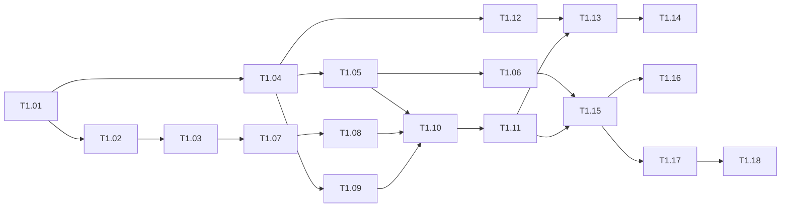

# Switchboard Roadmap and Tasks

Version 0.1, 2026-11-11. Status: draft for review.

Phases: **Phase 1** is the smallest impressive demo, **v1** completes the platform story, **v2** is the stretch roadmap. Every task is small enough for one evening, independently verifiable, and linked to acceptance criteria in [requirements.md](requirements.md). Estimates are hours of focused work and include tests.

Conventions for every task: tests pass locally, `ruff` and `mypy` clean, a span exists for any new boundary call, and anything that changes an interface gets a line in the relevant ADR or a new ADR.

## Phase 1: smallest impressive demo

Target: about 30 to 35 hours, roughly two weeks of evenings. Definition of done: the five minute demo in section "Phase 1 demo script" runs from a fresh clone with LM Studio on the host, and the README shows one measured routing and tool-call report.

| ID | Task | Est. h | Verification | AC |
| --- | --- | --- | --- | --- |
| T1.01 | Repo scaffold: `pyproject.toml` with uv, ruff, mypy strict, pytest, pre-commit, import-linter contract "core imports nothing", CI job for lint and unit tests | 1.5 | `uv run pytest` green with one placeholder test; CI green on push | G1 |
| T1.02 | Docker Compose: `postgres` (pgvector image, init SQL creating schemas, roles `switchboard_app` and `switchboard_tools`), `api`, `mcp-olist`, `web` placeholders, health checks, `.env.example` | 1.5 | `docker compose up` shows all services healthy; `GET /health` lists dependencies | AC-17a |
| T1.03 | Olist loader: `data/olist/README.md` with download steps, `schema.sql`, `switchboard data load-olist <dir>` loading the CSV files into schema `olist`, row count check | 2 | Loader prints row counts matching the documented numbers; `switchboard_tools` can SELECT and cannot INSERT (test) | AC-02b |
| T1.04 | Core: ports, domain models, errors, config loader (YAML plus env substitution), registry over entry points | 2.5 | Unit tests for config parsing and registry resolution; mypy strict passes | AC-08a |
| T1.05 | `OpenAICompatibleProvider`: completion, tool call normalization, structured output strategies 1 to 3 with repair, error mapping, usage and latency | 3 | Contract tests on recorded fixtures; live smoke script against LM Studio prints a routing decision | AC-08b |
| T1.06 | `MockProvider` with fixture recording and replay, `MockEmbedder`, `OpenAICompatibleEmbedder` | 1 | Contract tests pass for mock; embedding dimension check against config | AC-06c |
| T1.07 | MCP server `olist`: FastMCP over streamable HTTP, manifest, five read-only tools, read-only transaction, statement timeout, row cap, tenant allowlist check, audit insert | 3 | MCP inspector lists five tools; integration test calls each tool; write attempt test fails; audit row appears | AC-02a, AC-02b, AC-02c, AC-07b |
| T1.08 | `McpToolSource` adapter: list and call with tenant metadata and trace context propagation, error mapping | 1.5 | Contract tests against the server in a test container; denied tool is filtered from `list_tools` | AC-07b |
| T1.09 | Ingestion and `PgVectorRetriever`: chunking, embedding, upsert with content hash, HNSW index, vector search; write five synthetic policy documents | 2.5 | `switchboard ingest data/documents` twice: second run reports zero changes; retrieval test returns the expected chunk for three queries | AC-03b, AC-03c |
| T1.10 | Agents: `DirectAgent`, `RagAgent` with citations, `SqlAgent` with bounded tool loop, `MergeAgent` with missing-source handling | 3 | Unit tests with mock provider and in-process tool source; partial result when a branch fails | AC-03a, AC-04b, AC-04c |
| T1.11 | LangGraph orchestrator: supervisor node with structured routing, direct, rag, sql, fanout, merge, pass-through gate and cache nodes, attempts counter, run timeout | 3.5 | Integration test with mock provider covers all four routes; parallel spans overlap in time | AC-01b, AC-01c, AC-04a |
| T1.12 | Tracing: OTel setup, `PostgresSpanExporter`, span helpers with GenAI attributes, run persistence, trace context into MCP calls | 2.5 | After one request, `spans` contains run, supervisor, agent, chat and tool spans in one trace; GenAI attributes present | AC-05a, AC-05b |
| T1.13 | API: `POST /chat`, `GET /runs`, `GET /runs/{id}`, `GET /runs/{id}/trace`, `GET /health`; request validation; unknown tenant 404 | 1.5 | HTTP tests; OpenAPI docs render | AC-01a, AC-05a |
| T1.14 | Web UI (functional, unstyled): chat page, run list, trace tree with expand and collapse, attribute pane | 3 | Manual check against the API; builds in CI | AC-05c |
| T1.15 | Eval harness: runner, report writer, `routing` suite with 60 cases, `toolcall` suite with 40 cases, scorers, `--provider mock` path | 3.5 | `switchboard eval run --suite routing --provider mock` finishes under 30 s and writes both report files | AC-06a, AC-06b, AC-06c |
| T1.16 | CI: integration tests with a PostgreSQL service, eval smoke on mock, regression gate against baselines | 1.5 | A deliberate scorer change makes CI fail; revert makes it pass | AC-14a, AC-14b |
| T1.17 | First measured report on LM Studio: run both suites, commit reports, update the metrics table status from target to measured | 1.5 | Report files exist; README numbers link to them | G3 |
| T1.18 | README quick start, `docs/demo.md` five minute script, walkthrough "add a tool in three steps" | 1.5 | Fresh clone test following the README; timing recorded | AC-07a, AC-17b |

Total: 39 hours as estimated. Expect 30 to 35 with reuse across tasks, or cut T1.14 to a JSON trace view in the browser (saves 2 h) and defer the `parallel` route to v1 (saves 2 h) if the two weeks run out. See [review.md](review.md) for the cut order.

### Phase 1 demo script (five minutes)

1. `docker compose up` already running; show `GET /health` (30 s).
2. Ask "What is the return window for electronics?" in the UI; show route `rag` and the citation (45 s).
3. Ask "How many orders were delivered late in March 2018?"; show route `sql`, open the trace, expand the tool span, show arguments and the audit row (75 s).
4. Ask "Were late deliveries in March eligible for compensation?"; show route `parallel`, overlapping spans, merged answer (60 s).
5. Open `evals/reports/`, show the routing confusion matrix and the tool-call accuracy for the local model; say which numbers are measured and which are targets (45 s).
6. Show `mcp_servers/olist/tools/orders_late.py` and the manifest entry; explain that adding a tool is this file plus one manifest entry (45 s).

## v1: the platform story

Target: about 35 to 45 hours after Phase 1. Definition of done: provider comparison report on LM Studio and DeepSeek, cache and gate measured, tenant permissions demonstrated, UI styled.

| ID | Task | Est. h | Verification | AC |
| --- | --- | --- | --- | --- |
| T2.01 | Quality gate: judge call with structured verdict, escalation path, attempts limit, `gate` dataset with 30 cases, precision and recall in report | 4 | Integration test: weak answer triggers one re-route; report file | AC-09a, AC-09b, AC-09c |
| T2.02 | Semantic cache: `PgSemanticCache`, key scoping, TTL, invalidation on ingest, cache spans, `cache` dataset with 50 pairs, threshold sweep report | 5 | Test: paraphrase hits, near miss does not, re-ingest invalidates; report with threshold table | AC-10a to AC-10d |
| T2.03 | Hybrid retrieval: `tsvector` column, RRF, optional cross-encoder re-rank, `rag` dataset with 40 cases, recall@5 report for three strategies | 4 | Report shows all three strategies on the same dataset | metric RAG recall@5 |
| T2.04 | Tenant configuration: `tenants.yaml` schema, second demo tenant with seller filter, server-side allowlist and seller injection, cross-tenant tests | 3 | Tenant B cannot see tenant A's orders or chunks; denied tool shows in trace and audit | AC-11a to AC-11c |
| T2.05 | Injection guardrail: pattern set, flagging in blocks, span attributes, `injection` dataset with 40 samples, report | 3 | Report with detection and false positive rate | AC-12a to AC-12c |
| T2.06 | Audit API: `GET /audit`, redaction by `sensitive_args`, append-only grants test | 1.5 | HTTP test; grant test | AC-18a, AC-18b |
| T2.07 | Cost accounting: `prices.yaml` with verified dates, per-call cost on spans, per-run aggregation, `GET /runs` aggregation by day and provider | 2.5 | Unit test for price math; API test | AC-19a, AC-19b |
| T2.08 | DeepSeek provider config, cost cap and confirmation in the runner, fallback provider decorator | 2 | Dry run prints estimate and refuses without confirm; fallback test with a failing primary | AC-13b |
| T2.09 | Provider comparison: run routing, toolcall, rag on LM Studio and DeepSeek; `eval compare` table; README update | 3 | Comparison report committed; README table links to it | AC-13a |
| T2.10 | OTLP exporter option and Jaeger container in a compose profile | 1.5 | Same run visible in Jaeger | design 12.2 |
| T2.11 | Trace UI v2: timeline view, routing path graph, cache and gate markers | 4 | Manual check; screenshots in docs | AC-05c |
| T2.12 | Visual design pass (Apple-like style decided in a separate design session), responsive layout | 5 | Design checklist in `docs/ui.md` satisfied | G4 |
| T2.13 | Contract test suite completed for all ports with two implementations each where available | 2 | `pytest tests/contracts` parameterized over registered adapters | AC-08b |
| T2.14 | Optional: `langgraph-visualizer` dev integration flag | 1 | Graph renders live in the visualizer | design 12.3 |
| T2.15 | Docs: update ADRs, write interview notes (`docs/interview-notes.md`) with one paragraph per decision | 2 | Review by reading aloud in five minutes | G5 |

## v2: stretch roadmap

Not estimated in detail. Order reflects interview value per hour.

| ID | Task | Why | AC |
| --- | --- | --- | --- |
| T3.01 | `SequentialOrchestrator`: framework-free adapter passing the orchestrator contract tests and the routing suite | Proves the orchestrator port is real | AC-16a, AC-16b |
| T3.02 | Human-in-the-loop: interrupt before `write` or `require_approval` tools, `waiting_approval` status, approve and reject endpoints, one demo write tool behind approval | Shows the safety story end to end | AC-15a, AC-15b |
| T3.03 | `ModelRouter` policy: cheap model for routing, strong model for answers, cost and latency ceilings, measured savings | Routing by cost, latency and capability | design 8.4 |
| T3.04 | `query_readonly_sql@1` with sqlglot validation, disabled by default | Shows how a riskier tool is contained | design 7.1 |
| T3.05 | Anthropic provider adapter (native tool use and structured output) | Third provider, native tools comparison | AC-08a |
| T3.06 | Streaming responses over SSE in API and UI | Demo feel | G4 |
| T3.07 | TypeScript MCP server exposing a second data source (for example a public product catalog) | Second `ToolSource`, polyglot MCP | AC-07b |
| T3.08 | Valkey cache adapter behind the `Cache` port | Shows the port, benchmark against Postgres | ADR 0003 |
| T3.09 | LLM-as-judge answer quality scorer for the rag suite with agreement check against a small human-labeled sample | Honest quality metric | metric table |
| T3.10 | Azure Container Apps plus PostgreSQL flexible server plus Key Vault via Terraform, GitHub Actions deploy on tag | Cloud and IaC story | AC-20a |
| T3.11 | Conversation memory per session with tenant scoping | Product completeness | none yet |

## Dependencies

Parallelizable in Phase 1: T1.03 with T1.04; T1.07 with T1.05 and T1.09; T1.14 with T1.15.
